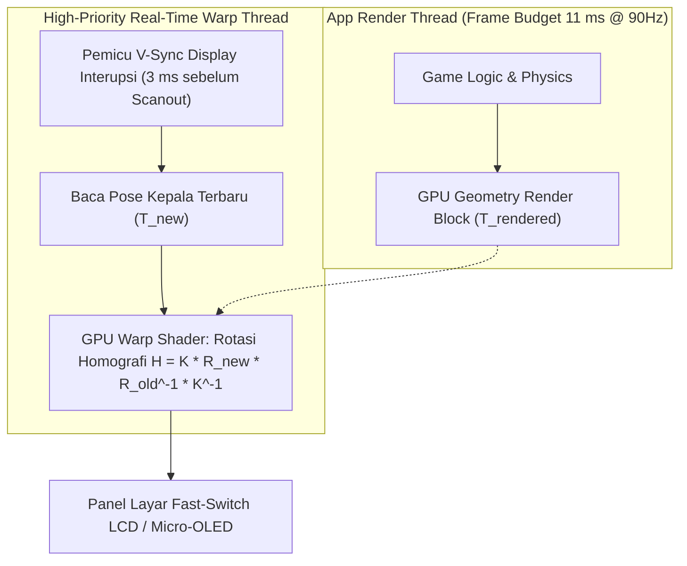

# Modul 229: Rekayasa Komputasi Spasial: VR / AR / XR (Pelacakan 6-DoF Inside-Out, Latensi Motion-to-Photon <20ms, Foveated Rendering)

**Navigasi**: [⬅️ Master Index](../../INDEX.md) | [Tingkat 16: Tingkat 16: Komputasi Performa Tinggi, Multimedia & Komputasi Kuantum](./README.md)
*Sebelumnya*: [228. arsitektur-mesin-game-simulasi-fisika](./228-arsitektur-mesin-game-simulasi-fisika.md) | *Berikutnya*: [230. rekayasa-kompresi-multimedia-codec](./230-rekayasa-kompresi-multimedia-codec.md)

---

## 1. Intuisi Dasar Tanpa Jargon ("Seperti Bayi Baru Lahir")
Pernahkah Anda mengenakan kacamata Virtual Reality (VR) dan setelah 5 menit Anda merasa pusing dan ingin muntah?

Penyakit ini disebut **Mual Siber (Cyber Sickness)**. Penyebabnya adalah keterlambatan waktu (*Latency*): ketika kepala Anda menoleh ke kiri, mata Anda berharap dunia virtual di dalam kacamata ikut bergeser secara instan. Jika headset Anda membutuhkan waktu lebih dari 20 milidetik untuk menggambar dunia baru tersebut, cairan di dalam telinga Anda memberi tahu otak: *"Tubuh kita sudah menoleh!"*, tetapi mata Anda melihat gambar yang tertinggal. Otak Anda menyimpulkan bahwa Anda telah menelan racun tanaman berhalusinasi, dan memicu refleks muntah untuk bertahan hidup! ([LaValle - Virtual Reality](https://vr.cs.uiuc.edu/)).

Untuk mencapai pengalaman komputasi spasial yang sempurna (**Virtual Reality, Augmented Reality & Spatial Computing** seperti Apple Vision Pro atau Meta Quest):
1. **Motion-to-Photon Latency < 20 ms**: Dari sensor gerakan kepala bergerak hingga photon cahaya layar menembak pupil mata, seluruh pipa komputasi harus selesai dalam sekejap mata.
2. **Inside-Out Tracking (6-DoF SLAM)**: Kamera-kamera kecil di bodi kacamata melacak posisi kepala Anda di ruangan secara mandiri tanpa butuh tiang sensor luar.
3. **Foveated Rendering**: Mata manusia hanya melihat tajam di lingkaran kecil berdiameter 2 derajat di tengah pupil (*fovea*). Headset melacak lirikan mata Anda (*Eye Tracking*) dan hanya merender tajam di titik yang sedang dilihat mata, menghemat beban kerja GPU hingga 75%! ([Patney et al. - Towards Foveated Rendering for Gaze-Tracked Displays](https://dl.acm.org/doi/10.1145/2980178.2980245)).

## 2. Fondasi Teoretis & Aksiomatik / Matematis
Formulasi Matematis Komputasi Spasial & Koreksi Optik:

1. **Anggaran Latensi Motion-to-Photon (M2P Latency Budget)**:
$$T_{\text{M2P}} = t_{\text{IMU Sample}} + t_{\text{Pose Fusion}} + t_{\text{Render App}} + t_{\text{GPU Draw}} + t_{\text{Display Scanout}} \le 20\text{ ms}$$
*Asynchronous Timewarp (ATW) / Late-Latching*: Tepat sebelum layar memindai pixel (*scanout*), citra hasil render terakhir dirotasi ulang secara homografi 2D di GPU berdasarkan orientasi kepala terbaru:
$$H = K \cdot R_{\text{new}} \cdot R_{\text{rendered}}^{-1} \cdot K^{-1}$$
Mengoreksi kesalahan orientasi kepala tanpa perlu merender ulang geometri 3D, memangkas latensi efektif ke tingkat sub-milidetik ([van Waveren - Asynchronous Timewarp on Oculus Rift](https://www.youtube.com/watch?v=WvtExV_Y1z8)).

2. **Koreksi Distorsi Lensa Optik (Brown-Conrady Radial Distortion)**:
Lensa Fresnel kacamata VR mendistorsi cahaya dengan efek bantalan jarum (*Pincushion Distortion*). GPU harus menerapkan distorsi tong terbalik (*Barrel Distortion*) pada gambar sebelum ditampilkan ke layar:
$$r_{\text{distorted}} = r (1 + k_1 r^2 + k_2 r^4 + k_3 r^6)$$
Di mana $r = \sqrt{x^2 + y^2}$, dan koefisien $k_i$ dikalibrasi terpisah untuk masing-masing kanal warna RGB guna meniadakan aberasi kromatik (*Chromatic Aberration*).

3. **Foveated Rendering Log-Polar Mapping**:
Kerapatan fotoreseptor kerucut (*cone cells*) pada retina manusia meluruh eksponensial terhadap sudut eksentrisitas fovea $\theta$:
$$\text{Visual Acuity}(\theta) = \frac{1}{1 + e_0 \cdot \theta}$$
Tingkat resolusi render shading diskalakan mengikuti kurva resolusi biologis fovea ([Guenter et al. - Foveated 3D Graphics](https://dl.acm.org/doi/10.1145/2366145.2366183)).

## 3. Anatomi Teknis & Cara Kerja Internal
Arsitektur eksekusi pipeline grafis latensi ultra-rendah Asynchronous Timewarp (ATW):



Dengan Asynchronous Timewarp (ATW), bahkan jika game mengalami penurunan performa mendadak (*frame drop*), gambar di headset tidak akan pernah bergetar atau membuat pengguna mual karena frame lama diproyeksikan ulang secara mulus mengikuti perputaran kepala pengguna ([LaValle VR Book Chapter 7](https://vr.cs.uiuc.edu/)).

## 4. Implementasi Praktis & Kode / Simulasi Riil
```python
import numpy as np

# 1. Implementasi Koreksi Distorsi Optik Lensa Kacamata VR (Brown-Conrady Barrel Distortion)
def apply_barrel_distortion(x, y, k1=0.22, k2=0.24):
    # Jarak radial dari pusat optik lensa (asumsi pusat lensa di 0,0)
    r2 = x**2 + y**2
    r4 = r2**2
    
    # Faktor penskalaan distorsi tong
    distortion_factor = 1.0 + k1 * r2 + k2 * r4
    
    x_distorted = x * distortion_factor
    y_distorted = y * distortion_factor
    return x_distorted, y_distorted

# 2. Asynchronous Timewarp (ATW) Homography Re-Projection Matrix
def compute_atw_homography(yaw_rendered, yaw_current, fov_deg=90.0):
    # Rotasi Yaw sederhana mengelilingi sumbu Y
    delta_yaw = yaw_current - yaw_rendered
    
    # Matriks Rotasi Selisih Delta_R
    c = np.cos(delta_yaw)
    s = np.sin(delta_yaw)
    R_delta = np.array([
        [ c, 0.0, s],
        [0.0, 1.0, 0.0],
        [-s, 0.0, c]
    ])
    
    # Matriks Intrinsik Kamera Ideal K
    f = 1.0 / np.tan(np.radians(fov_deg / 2.0))
    K = np.array([
        [f, 0.0, 0.0],
        [0.0, f, 0.0],
        [0.0, 0.0, 1.0]
    ])
    
    # Matriks Warp Homografi: H = K * R_delta * K^-1
    H = K @ R_delta @ np.linalg.inv(K)
    return H

# Uji Coba Distorsi Lensa
x_norm, y_norm = 0.8, 0.6 # Titik di tepi lensa optik
xd, yd = apply_barrel_distortion(x_norm, y_norm)
print(f"Titik Asal Tepi Layar      : ({x_norm:.2f}, {y_norm:.2f})")
print(f"Titik Pasca-Distorsi Lensa : ({xd:.2f}, {yd:.2f}) (Diperluas untuk melawan distorsi optik!)")

# Uji Coba ATW Reprojection saat kepala bergerak 2 derajat selama render frame
H_warp = compute_atw_homography(yaw_rendered=0.0, yaw_current=np.radians(2.0))
print(f"\nMatriks Homografi Warp ATW (Sub-Milidetik):\n{np.round(H_warp, 3)}")
```

## 5. Miskonsepsi & Jebakan Industri
*Vergence-Accommodation Conflict (VAC)*: Pada headset VR layar tunggal konvensional, mata pengguna selalu memfokuskan lensa kristalin matanya (*Accommodation*) pada jarak layar fisik tetap yang berjarak 2 meter di depan mata. Namun, petunjuk stereoskopis (*Vergence*) memaksa kedua bola mata menyatu melihat objek virtual yang berada 20 sentimeter di ujung hidung. Konflik neurologis antara sinyal akomodasi dan vergensi ini memicu kelelahan mata ekstrem (*eye strain*) dan sakit kepala setelah pemakaian 30 menit. Solusi mutlak masa depan: optik fokus variabel (*Varifocal Displays*) atau layar medan cahaya (*Light Field Displays*) ([Hoffman et al. - Vergence-Accommodation Conflicts in Stereoscopic Displays](https://jov.arvojournals.org/article.aspx?articleid=2122119)).

## 6. Proyek Latihan & Rubrik Penilaian Mandiri
### Level 1 (Pemula)
Tulis modul penyesuaian matriks proyeksi stereoskopis sepasang mata (*Stereo Projection Matrix*): buat dua matriks kamera perspektif yang digeser sejauh jarak pupil mata (*Interpupillary Distance / IPD* $64\text{ mm}$) ke kiri dan kanan dengan konvergensi sumbu optik sejajar (*parallel off-axis asymmetric frustum*).
*Rubrik*: Menghasilkan proyeksi frustum mata kiri dan kanan dengan pergeseran horizontal yang tepat.

### Level 2 (Menengah)
Bangun simulator fragment shader OpenGL/Vulkan untuk Foveated Rendering: terima posisi lirikan pupil $(x_c, y_c)$, bagi layar menjadi tiga zona melingkar konsentris (Zona Fovea tajam 100% resolusi, Zona Periferal Tengah 50% resolusi, Zona Periferal Luar 20% resolusi), dan ukur penghematan pixel yang diproses.
*Rubrik*: Pengurangan total beban evaluasi fragment shader mencapai $> 60\%$ tanpa artefak garis lingkaran tajam (menggunakan transisi interpolasi halus).

### Level 3 (Mahir)
Implementasikan sistem pelacakan kepala 6-DoF Visual-Inertial Odometry (VIO) Inside-Out mini: fusi data IMU frekuensi tinggi ($500\text{ Hz}$) dengan ekstraksi fitur titik sudut kamera FAST ($30\text{ Hz}$) menggunakan filter Extended Kalman Filter (MSCKF - Multi-State Constraint Kalman Filter), hitung kompensasi time-lag kalibrasi temporal, dan buktikan kestabilan pose navigasi di dalam ruangan tanpa bantuan GPS luar.
*Rubrik*: Estimasi translasi dan rotasi kepala 6-DoF stabil dan kontinu tanpa lonjakan posisi.

## 7. Rekomendasi Sumber Belajar Standar Emas
| Sumber Pembelajaran | Penulis / Institusi | Tautan Langsung | Fokus Materi |
| :--- | :--- | :--- | :--- |
| Virtual Reality | Steven M. LaValle (UIUC / Oculus Chief Scientist) | [Free Cambridge Online Book](https://vr.cs.uiuc.edu/) | Alkitab Fisika Komputasi Spasial, Lensa Optik, Fisiologi Mata, ATW |
| Towards Foveated Rendering for Gaze-Tracked Displays | Anjul Patney et al. (NVIDIA Research) | [ACM Transactions on Graphics](https://dl.acm.org/doi/10.1145/2980178.2980245) | Algoritma Foveated Rendering Berbasis Pelacakan Retina Mata |
| Vergence-Accommodation Conflicts in Stereoscopic Displays | David M. Hoffman et al. | [Journal of Vision 2008](https://jov.arvojournals.org/article.aspx?articleid=2122119) | Analisis Medis & Fisiologis Konflik Akomodasi Mata Manusia |
| OpenXR Specification & Developer Guide | Khronos Group OpenXR Working Group | [Khronos OpenXR Portal](https://www.khronos.org/openxr/) | Standar Industri Terbuka Portabilitas Aplikasi VR / AR / XR |

---
*Navigasi Cepat*: [Ke Tingkat 16](./README.md) | [Ke Master Index](../../INDEX.md) | *Sebelumnya*: [228. arsitektur-mesin-game-simulasi-fisika](./228-arsitektur-mesin-game-simulasi-fisika.md) | *Berikutnya*: [230. rekayasa-kompresi-multimedia-codec](./230-rekayasa-kompresi-multimedia-codec.md)
