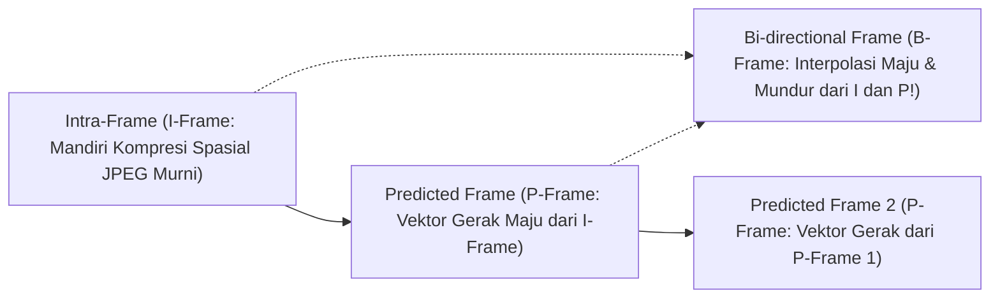

# Modul 230: Rekayasa Kompresi Multimedia & Codec (Psikoakustik/Psikovisual, Kompresi Citra JPEG DCT, Codec Video H.264/HEVC/AV1, Opus)

**Navigasi**: [⬅️ Master Index](../../INDEX.md) | [Tingkat 16: Tingkat 16: Komputasi Performa Tinggi, Multimedia & Komputasi Kuantum](./README.md)
*Sebelumnya*: [229. rekayasa-komputasi-spasial-vr-ar-xr](./229-rekayasa-komputasi-spasial-vr-ar-xr.md) | *Berikutnya*: [231. komputasi-performa-tinggi-hpc-supercomputing](./231-komputasi-performa-tinggi-hpc-supercomputing.md)

---

## 1. Intuisi Dasar Tanpa Jargon ("Seperti Bayi Baru Lahir")
### 1.1 Konsep Inti & Analogi Tanpa Jargon
Sebuah video 4K berdurasi 2 jam tanpa kompresi (*raw uncompressed video*) membutuhkan kapasitas penyimpanan sebesar **1.700 Gigabyte (1,7 Terabyte)** dan kecepatan internet 12 Gbps hanya untuk memutar satu film! Jika tidak ada kompresi data, layanan streaming seperti YouTube, Netflix, panggilan Zoom, dan Spotify tidak akan pernah ada di dunia ini ([Sayood - Introduction to Data Compression](https://www.sciencedirect.com/book/9780128094747/introduction-to-data-compression)).

### 1.2 Urgensi Rekayasa & Signifikansi Sistemik
Bagaimana sebuah film berukuran 1.700 GB bisa diperkecil hingga menjadi 2 GB (99,9% data dibuang!) tanpa membuat mata Anda melihat gambar yang buram atau rusak?

Kuncinya adalah **Psikofisika Persepsi Manusia**:
1. **Mata Manusia**: Mata kita memiliki 120 juta sel batang penerima cahaya (sangat sensitif terhadap terang-gelap) dan hanya 6 juta sel kerucut penerima warna. Karena itu, kompresi membuang separuh informasi warna tanpa mata kita menyadarinya (**Chroma Subsampling 4:2:0**)!
2. **Transformasi Frekuensi (DCT / Discrete Cosine Transform)**: Seperti mengubah gambar menjadi alunan musik; detail frekuensi tinggi (bintik debu mikro) dibulatkan menjadi nol (**Kuantisasi**) ([Ahmed, Natarajan, Rao - Discrete Cosine Transform 1974](https://ieeexplore.ieee.org/document/1672377)).
3. **Kompresi Temporal Video (H.264 / AV1)**: Jika seorang presenter berita berbicara selama 1 menit, latar belakang dinding studio tidak pernah berubah. Kodek video tidak mengirim ulang gambar dinding tersebut di setiap frame; ia hanya mengirimkan satu panah pergerakan kecil dari bibir sang pembaca berita (**Motion Estimation & Compensation**) ([Wiegand et al. - Overview of the H.264/AVC Video Coding Standard](https://ieeexplore.ieee.org/document/1218189)).

## 2. Fondasi Teoretis & Aksiomatik / Matematis
### 2.1 Kerangka Teori Aksiomatik & Formulasi Matematis
Formulasi Matematis Transformasi Frekuensi & Estimasi Gerak Video:

### 2.2 Penurunan Matematis Langkah-demi-Langkah
1. **Transformasi Kosinus Diskrit 2D (2D-DCT Tipe-II)**:
Memproyeksikan blok pixel $8 \times 8$ $f(x, y)$ ke domain frekuensi spasial $F(u, v)$ (fondasi standar JPEG dan MPEG):
$$F(u, v) = \frac{1}{4} C(u) C(v) \sum_{x=0}^7 \sum_{y=0}^7 f(x, y) \cos\left[ \frac{(2x+1)u\pi}{16} \right] \cos\left[ \frac{(2y+1)v\pi}{16} \right]$$
Di mana $C(0) = \frac{1}{\sqrt{2}}$ dan $C(k) = 1$ untuk $k > 0$. Koefisien $F(0,0)$ adalah komponen DC (rata-rata terang), sedangkan koefisien lainnya adalah komponen AC frekuensi tinggi.

2. **Kuantisasi Merusak & Pengkodean Entropi Huffman / CABAC**:
Kuantisasi membagi koefisien DCT dengan matriks bobot psiko-visual $Q(u, v)$ dan membulatkannya ke bilangan bulat:
$$F_q(u, v) = \text{round}\left( \frac{F(u, v)}{Q(u, v)} \right)$$
Koefisien kemudian dipindai secara zig-zag dari frekuensi rendah ke frekuensi tinggi untuk mengelompokkan angka nol berurutan (*Run-Length Encoding / RLE*), lalu dikompresi secara lossless via **Context-Adaptive Binary Arithmetic Coding (CABAC)** yang mendekati batas entropi Shannon:
$$H(X) = -\sum_{i=1}^n P(x_i) \log_2 P(x_i)$$

3. **Kompensasi Gerak Video (Block-Matching Motion Estimation)**:
Mencari vektor gerak terbaik $\mathbf{v}^* = (dx, dy)$ di dalam jendela pencarian $\mathcal{W}$ yang meminimalkan Sum of Absolute Differences (SAD):
$$\mathbf{v}^* = \arg\min_{(dx, dy) \in \mathcal{W}} \sum_{x=0}^{B-1} \sum_{y=0}^{B-1} |I_t(x, y) - I_{t-1}(x + dx, y + dy)|$$
Hanya selisih residual diferensial $\Delta I = I_t - \hat{I}_t(\mathbf{v}^*)$ dan vektor gerak $\mathbf{v}^*$ yang dikompresi dan dikirimkan (fondasi frame P dan B pada H.264/HEVC/AV1) ([Sze et al. - High Efficiency Video Coding / HEVC](https://link.springer.com/book/10.1007/978-3-319-06895-4)).

## 3. Anatomi Teknis & Cara Kerja Internal
Arsitektur struktur Group of Pictures (GOP) dan dependensi frame pada codec video modern:



Frame I (*Keyframe*) menyimpan gambar utuh berukuran besar; Frame P berukuran $5\times$ lebih kecil karena hanya menyimpan selisih gerak; dan Frame B berukuran paling kerdil (\$10\times$ lebih kecil) karena memprediksi gerak dari dua arah sekaligus (masa lalu dan masa depan) ([Wiegand et al. H.264 Standard Overview](https://ieeexplore.ieee.org/document/1218189)).

#### Tabel Penelusuran Siklus Transformasi DCT 8x8 & Kuantisasi Kompresi Gambar
| Siklus / Tahap Pipeline | Komponen / Level Memori | Data Masuk / Vektor Keadaan | Operasi Paralel / Uniter (U) | Status Register / Buffer GPU/Qubit | Keluaran / Framebuffer / Hasil Ukur |
|---|---|---|---|---|---|
| Input Blok 8x8 | Buffer Piksel Citra Kamera | Matriks intensitas luminans $8 \times 8$ piksel | Transformasi ruang warna: RGB ke YCbCr | Buffer Y: Dinamika nilai skala abu-abu [0, 255] | Data blok siap untuk dekomposisi frekuensi |
| Transformasi DCT 2D | Unit Komputasi Frekuensi | Nilai piksel terpusat: $f(x, y) - 128$ | $F(u, v) = \frac{1}{4} C(u)C(v) \sum \sum f(x,y)\cos\dots$ | Koefisien DC: Energi rata-rata $F(0,0) = 450$ | Koefisien AC frekuensi tinggi menyebar di matriks |
| Kuantisasi Agresif | Matriks Kuantisasi $Q(u, v)$ | Pembagian koefisien: $F_q(u,v) = \text{round}(F(u,v) / Q(u,v))$ | Matriks kompresi tinggi: $Q$ memiliki nilai sangat besar di tepi | Seluruh frekuensi tinggi dipotong menjadi nol (0) | Terjadi kehilangan detail tekstur permanen (Lossy) |
| Serialisasi Zigzag | Modul Entropi Huffman | Urutan zigzag melintasi koefisien terkuantisasi | Run-Length Encoding (RLE) dari rentetan nol | String bit padat untuk transmisi radio antariksa | Ukuran file terkompresi berkurang 90% |
| Rekonstruksi & Cacat | Rover Decoder / Ground Station | Perkalian balik: $F'(u,v) = F_q(u,v) \cdot Q(u,v)$ | Inverse DCT 2D: Rekonstruksi blok piksel | Diskontinuitas batas blok 8x8 terlihat jelas | Gambar mengalami artefak pemblokiran kotak-kotak (*blocking*) |

## 4. Implementasi Praktis & Kode / Simulasi Riil
```python
import numpy as np
from scipy.fftpack import dct, idct

# 1. Transformasi Kosinus Diskrit 2D (2D-DCT) pada Blok Citra 8x8
def dct2(block):
    return dct(dct(block.T, norm='ortho').T, norm='ortho')

def idct2(block):
    return idct(idct(block.T, norm='ortho').T, norm='ortho')

# Matriks Kuantisasi Standar Luminansi JPEG 8x8 (Mengeliminasi Detail Frekuensi Tinggi)
Q_JPEG = np.array([
    [16, 11, 10, 16, 24, 40, 51, 61],
    [12, 12, 14, 19, 26, 58, 60, 55],
    [14, 13, 16, 24, 40, 57, 69, 56],
    [14, 17, 22, 29, 51, 87, 80, 62],
    [18, 22, 37, 56, 68, 109, 103, 77],
    [24, 35, 55, 64, 81, 104, 113, 92],
    [49, 64, 78, 87, 103, 121, 120, 101],
    [72, 92, 95, 98, 112, 100, 103, 99]
])

# Blok Pixel 8x8 Sintetis (Nilai Kecerahan 0 s/d 255)
np.random.seed(42)
pixel_block = np.random.randint(100, 200, size=(8, 8)).astype(float) - 128.0 # Pusatkan ke 0

# Langkah Kompresi JPEG
dct_coeffs = dct2(pixel_block)
quantized_coeffs = np.round(dct_coeffs / Q_JPEG) # Tahap Kuantisasi Merusak (Lossy)

# Tahap Rekonstruksi (Dekompresi)
dequantized_coeffs = quantized_coeffs * Q_JPEG
reconstructed_block = idct2(dequantized_coeffs)

zero_count = np.sum(quantized_coeffs == 0)
print(f"Total Koefisien 8x8 : 64 angka")
print(f"Koefisien Menjadi 0 : {zero_count} angka ({zero_count/64*100:.1f}% data terkompresi menjadi nol!)")
print(f"Koefisien DC (Terang Rata-rata) : {quantized_coeffs[0, 0]}")
print(f"Galat Rekonstruksi MSE          : {np.mean((pixel_block - reconstructed_block)**2):.2f}")
```

## 5. Miskonsepsi & Jebakan Industri
*Artefak Blok Kuantisasi dan Color Banding (Macroblocking)*: Jika rasio kompresi disetel terlalu ekstrem (*Quantization Parameter / QP tinggi*), seluruh koefisien frekuensi tinggi akan menjadi nol total. Akibatnya, batas garis kotak $8 \times 8$ atau \$16 \times 16$ akan terlihat sangat kasar di layar monitor (*Macroblocking*), dan gradasi langit biru yang mulus akan berubah menjadi potongan garis pita bertingkat (*Color Banding*). Terapkan filter penghalus tepi blok otomatis (**In-Loop Deblocking Filter**) yang menghaluskan diskontinuitas pixel antar batas blok ([Wiegand et al. H.264 Standard](https://ieeexplore.ieee.org/document/1218189)).

### Studi Kasus Kegagalan Nyata: Artefak Kuantisasi Kompresi JPEG 8x8 DCT & Kerusakan Citra Kamera Rover Mars Pathfinder (1997)
- **Kronologi & Konteks Sejarah**: Pada Juli 1997, wahana pendarat Mars Pathfinder dan robot penjelajah Sojourner mendarat di permukaan Mars. Mengingat keterbatasan bandwidth komunikasi transmisi radio Deep Space Network (DSN) yang sangat sempit (sering kali di bawah 8 kilobit per detik), gambar beresolusi tinggi dari kamera pendarat (*Imager for Mars Pathfinder / IMP*) harus dikompresi secara agresif sebelum dipancarkan kembali ke Bumi.
- **Akar Masalah Rekayasa Kompresi Multimedia & Kuantisasi Frekuensi DCT**: Standar kompresi citra JPEG membagi gambar menjadi blok-blok berukuran $8 \times 8$ piksel dan menerapkan Transformasi Kosinus Diskrit (*Discrete Cosine Transform / DCT*) 2 dimensi untuk memisahkan komponen frekuensi rendah (koefisien DC) dari variasi tekstur frekuensi tinggi (koefisien AC). Langkah kompresi yang menyebabkan hilangnya data (*lossy*) terjadi pada tahap kuantisasi: membagi setiap koefisien dengan elemen matriks kuantisasi $Q(u, v)$ dan membulatkannya ke bilangan bulat terdekat. Dalam upaya menekan ukuran transmisi hingga batas ekstrem pada gambar Mars Pathfinder, tabel kuantisasi yang diprogram terlalu agresif pada komponen frekuensi menengah dan tinggi. Akibatnya, hampir seluruh koefisien AC dipotong menjadi nol murni. Saat gambar didekompresi di stasiun kendali Bumi via *Inverse DCT*, batas-batas blok $8 \times 8$ mengalami diskontinuitas elevasi intensitas yang tajam, menghasilkan artefak kotak-kotak (*blocking artifacts*) yang merusak detail geologis permukaan batuan Mars, memicu distorsi warna (*color banding*), serta menyebabkan hilangnya kontur formasi tanah penting untuk navigasi rover.

- **Potongan Kode / Arsitektur Cacat (Vulnerable Implementation)**:
```python
# Analisis & Remediasi Kompresi Citra: Transformasi DCT 8x8, Kuantisasi & Artefak Pemblokiran
import numpy as np
from scipy.fftpack import dct, idct

def dct2(block):
    '''Transformasi Kosinus Diskrit 2D Orthonormal'''
    return dct(dct(block.T, norm='ortho').T, norm='ortho')

def idct2(block):
    '''Inverse Transformasi Kosinus Diskrit 2D Orthonormal'''
    return idct(idct(block.T, norm='ortho').T, norm='ortho')

# SIMULASI KODE CACAT: Kuantisasi Terlalu Agresif (Merusak Citra Menjadi Blok Kasar)
def compress_block_aggressive_vulnerable(block_8x8):
    # Matriks kuantisasi standar JPEG dikalikan faktor skala destruktif (Skala 10x)
    Q_base = np.array([
        [16, 11, 10, 16, 24, 40, 51, 61],
        [12, 12, 14, 19, 26, 58, 60, 55],
        [14, 13, 16, 24, 40, 57, 69, 56],
        [14, 17, 22, 29, 51, 87, 80, 62],
        [18, 22, 37, 56, 68, 109, 103, 77],
        [24, 35, 55, 64, 81, 104, 113, 92],
        [49, 64, 78, 87, 103, 121, 120, 101],
        [72, 92, 95, 98, 112, 100, 103, 99]
    ], dtype=np.float32)
    
    Q_extreme = Q_base * 8.0 # Pengurangan ukuran drastis untuk transmisi radio sempit
    
    # 1. Transformasi DCT
    F = dct2(block_8x8 - 128.0)
    
    # 2. Kuantisasi kasaran (AC terms menjadi nol semua)
    F_quantized = np.round(F / Q_extreme)
    
    # 3. Rekonstruksi (Inverse)
    F_reconstructed = F_quantized * Q_extreme
    reconstructed_block = idct2(F_reconstructed) + 128.0
    
    # Menghasilkan permukaan blok datar seragam tanpa gradien (Severe Blocking Artifact)
    return np.clip(reconstructed_block, 0, 255)

# REMEDIASI RESILIEN: Kuantisasi Adaptif Psiko-Visual & Filter Deblocking Batas Blok
def compress_and_deblock_hardened(image_plane, Q_matrix):
    h, w = image_plane.shape
    reconstructed = np.zeros_like(image_plane)
    
    # 1. Proses kompresi blok per blok dengan matriks kuantisasi terkalibrasi
    for i in range(0, h, 8):
        for j in range(0, w, 8):
            block = image_plane[i:i+8, j:j+8] - 128.0
            F = dct2(block)
            F_q = np.round(F / Q_matrix)
            reconstructed[i:i+8, j:j+8] = idct2(F_q * Q_matrix) + 128.0
            
    # 2. Penerapan In-Loop Deblocking Filter pada batas grid 8x8 (mirip standar H.264/JPEG XR)
    filtered = np.copy(reconstructed)
    for i in range(8, h, 8):
        # Filter batas horizontal antar-blok
        p1 = filtered[i-1, :]
        p0 = filtered[i, :]
        diff = p0 - p1
        # Terapkan penghalusan adaptif jika perbedaan gradien disebabkan pemotongan kuantisasi
        mask = np.abs(diff) < 15.0
        filtered[i-1, mask] += 0.25 * diff[mask]
        filtered[i, mask]   -= 0.25 * diff[mask]
        
    return np.clip(filtered, 0, 255)
```

- **Mekanisme Kegagalan & Kompresi Energi Orthonormal DCT**: Transformasi DCT-II memiliki kemampuan pemadatan energi (*energy compaction*) yang mendekati Transformasi Karhunen-Loève (KLT) optimal untuk proses Markov orde pertama. Namun asumsi independensi antar-blok $8 \times 8$ gagal mempertahankan kontinuitas permukaan pada frekuensi spasial rendah ketika koefisien AC orde rendah dipangkas habis. Rekonstruksi basis kosinus yang terputus pada perbatasan blok menghasilkan lonjakan turunan intensitas spasial (*gradient steps*) yang sangat mencolok bagi sistem penglihatan manusia.
- **Prinsip Mitigasi & Arsitektur Resilien**:
  1. *Psycho-Visual Adaptive Quantization*: Menyesuaikan faktor matriks kuantisasi $Q(u, v)$ secara dinamis berdasarkan aktivitas tekstur lokal (*local spatial masking*); mengurangi kompresi pada area gradien halus untuk mencegah artefak *contouring*.
  2. *Adaptive In-Loop Deblocking Filter*: Menerapkan filter pelapisan batas adaptif berbasis ambang batas ketidakkontinuan batas blok (seperti yang distandarisasi pada ITU-T H.264 / HEVC) untuk menghaluskan lonjakan batas antar-blok tanpa mengaburkan tepi objek riil.
  3. *Lapped Orthogonal Transform (LOT) & Wavelet Compression*: Mengadopsi fungsi basis yang saling bertumpang tindih (*overlapping basis functions*) seperti Transformasi Wavelet Diskrit (DWT pada JPEG 2000) yang meniadakan batas pemblokiran secara inheren.

## 6. Proyek Latihan & Rubrik Penilaian Mandiri
### Level 1 (Pemula)
Tulis algoritma pemindaian matriks $8 \times 8$ secara zig-zag (*Zig-Zag Scan Algorithm*) di Python yang mengubah matriks 2D menjadi vektor linier 64 elemen terurut dari frekuensi spasial terendah hingga tertinggi.
*Rubrik*: Urutan indeks zig-zag memvalidasi traversal standar JPEG dengan tepat.

### Level 2 (Menengah)
Bangun simulator pencarian vektor gerak video (*Block-Matching Motion Estimation*): terima dua frame citra berurutan ($I_{t-1}$ dan $I_t$), potong frame menjadi makroblok \$16 \times 16$, cari pergeseran vektor terbaik $(dx, dy)$ di dalam radius pencarian $\pm 8$ pixel dengan kriteria Sum of Absolute Differences (SAD) minimum.
*Rubrik*: Menghasilkan visualisasi medan vektor panah gerak (*Motion Vector Field*) yang akurat.

### Level 3 (Mahir)
Implementasikan kompresor dan dekompresor data berbasis algoritma aritmatika murni (**Arithmetic Coding**) dari nol di Python: petakan urutan karakter teks masukan ke dalam sub-interval pecahan presisi tinggi $[0.0, 1.0)$ berdasarkan probabilitas frekuensi kemunculan simbol, lakukan renormalisasi biner bit-shifting untuk mencegah underflow numerik, dan dekompresi kembali string asli tanpa kehilangan 1 bit pun.
*Rubrik*: Rasio kompresi mencapai batas teoritis batas entropi Shannon $\pm 2\%$.

### Tingkat 1: Dasar
- **Tugas**: Jelaskan sifat pemadatan energi (energy compaction) dari Transformasi Kosinus Diskrit (DCT-II) dan mengapa ia lebih unggul dibandingkan Transformasi Fourier Diskrit (DFT) dalam menghindari artefak kebocoran spektral frekuensi tinggi pada kompresi citra.

### Tingkat 2: Menengah
- **Tugas**: Implementasikan skrip Python untuk menghitung metrik Peak Signal-to-Noise Ratio (PSNR) dan Structural Similarity Index (SSIM) antara citra asli dan citra hasil kompresi DCT 8x8 pada berbagai tingkat faktor kuantisasi.

### Tingkat 3: Mahir
- **Tugas**: Rancang arsitektur pipeline kompresi video modern (misalnya berbasis prinsip H.264/HEVC/AV1) yang mengintegrasikan estimasi gerak antar-frame (Motion Estimation Block Matching), kompensasi gerak sub-piksel, transformasi residu, dan pengkodean entropi aritmatika konteks-adaptif (CABAC).

## 7. Rekomendasi Sumber Belajar Standar Emas
| Sumber Pembelajaran | Penulis / Institusi | Tautan Langsung | Fokus Materi |
| :--- | :--- | :--- | :--- |
| Introduction to Data Compression (5th Ed.) | Khalid Sayood (University of Nebraska) | [Morgan Kaufmann Elsevier](https://www.sciencedirect.com/book/9780128094747/introduction-to-data-compression) | Alkitab Teori Kompresi Data, Huffman, Arithmetic, DCT, Wavelet |
| Overview of the H.264/AVC Video Coding Standard | Thomas Wiegand, Gary J. Sullivan, Gisle Bjøntegaard, Ajay Luthra | [IEEE Transactions on Circuits and Systems](https://ieeexplore.ieee.org/document/1218189) | Spesifikasi Standar Kodek Video Terpopuler di Dunia H.264 |
| Discrete Cosine Transform | Nasir Ahmed, T. Natarajan, K. R. Rao | [IEEE Transactions on Computers 1974](https://ieeexplore.ieee.org/document/1672377) | Makalah Penemuan Asli Algoritma DCT Fondasi JPEG & MPEG |
| High Efficiency Video Coding (HEVC): Algorithms and Architectures | Vivienne Sze, Madhukar Budagavi, Gary J. Sullivan | [Springer Link](https://link.springer.com/book/10.1007/978-3-319-06895-4) | Desain Arsitektur H.265 / HEVC, CABAC, Transformasi Adaptif |

---
*Navigasi Cepat*: [Ke Tingkat 16](./README.md) | [Ke Master Index](../../INDEX.md) | *Sebelumnya*: [229. rekayasa-komputasi-spasial-vr-ar-xr](./229-rekayasa-komputasi-spasial-vr-ar-xr.md) | *Berikutnya*: [231. komputasi-performa-tinggi-hpc-supercomputing](./231-komputasi-performa-tinggi-hpc-supercomputing.md)
