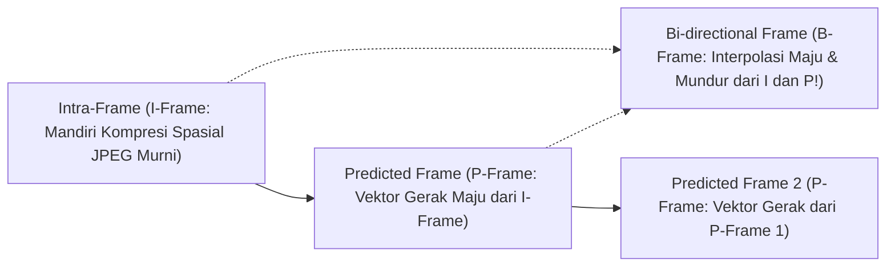

# Modul 230: Rekayasa Kompresi Multimedia & Codec (Psikoakustik/Psikovisual, Kompresi Citra JPEG DCT, Codec Video H.264/HEVC/AV1, Opus)

**Navigasi**: [⬅️ Master Index](../../INDEX.md) | [Tingkat 16: Tingkat 16: Komputasi Performa Tinggi, Multimedia & Komputasi Kuantum](./README.md)
*Sebelumnya*: [229. rekayasa-komputasi-spasial-vr-ar-xr](./229-rekayasa-komputasi-spasial-vr-ar-xr.md) | *Berikutnya*: [231. komputasi-performa-tinggi-hpc-supercomputing](./231-komputasi-performa-tinggi-hpc-supercomputing.md)

---

## 1. Intuisi Dasar Tanpa Jargon ("Seperti Bayi Baru Lahir")
Sebuah video 4K berdurasi 2 jam tanpa kompresi (*raw uncompressed video*) membutuhkan kapasitas penyimpanan sebesar **1.700 Gigabyte (1,7 Terabyte)** dan kecepatan internet 12 Gbps hanya untuk memutar satu film! Jika tidak ada kompresi data, layanan streaming seperti YouTube, Netflix, panggilan Zoom, dan Spotify tidak akan pernah ada di dunia ini ([Sayood - Introduction to Data Compression](https://www.sciencedirect.com/book/9780128094747/introduction-to-data-compression)).

Bagaimana sebuah film berukuran 1.700 GB bisa diperkecil hingga menjadi 2 GB (99,9% data dibuang!) tanpa membuat mata Anda melihat gambar yang buram atau rusak?

Kuncinya adalah **Psikofisika Persepsi Manusia**:
1. **Mata Manusia**: Mata kita memiliki 120 juta sel batang penerima cahaya (sangat sensitif terhadap terang-gelap) dan hanya 6 juta sel kerucut penerima warna. Karena itu, kompresi membuang separuh informasi warna tanpa mata kita menyadarinya (**Chroma Subsampling 4:2:0**)!
2. **Transformasi Frekuensi (DCT / Discrete Cosine Transform)**: Seperti mengubah gambar menjadi alunan musik; detail frekuensi tinggi (bintik debu mikro) dibulatkan menjadi nol (**Kuantisasi**) ([Ahmed, Natarajan, Rao - Discrete Cosine Transform 1974](https://ieeexplore.ieee.org/document/1672377)).
3. **Kompresi Temporal Video (H.264 / AV1)**: Jika seorang presenter berita berbicara selama 1 menit, latar belakang dinding studio tidak pernah berubah. Kodek video tidak mengirim ulang gambar dinding tersebut di setiap frame; ia hanya mengirimkan satu panah pergerakan kecil dari bibir sang pembaca berita (**Motion Estimation & Compensation**) ([Wiegand et al. - Overview of the H.264/AVC Video Coding Standard](https://ieeexplore.ieee.org/document/1218189)).

## 2. Fondasi Teoretis & Aksiomatik / Matematis
Formulasi Matematis Transformasi Frekuensi & Estimasi Gerak Video:

1. **Transformasi Kosinus Diskrit 2D (2D-DCT Tipe-II)**:
Memproyeksikan blok pixel $8 \times 8$ $f(x, y)$ ke domain frekuensi spasial $F(u, v)$ (fondasi standar JPEG dan MPEG):
$$F(u, v) = \frac{1}{4} C(u) C(v) \sum_{x=0}^7 \sum_{y=0}^7 f(x, y) \cos\left[ \frac{(2x+1)u\pi}{16} \right] \cos\left[ \frac{(2y+1)v\pi}{16} \right]$$
Di mana $C(0) = \frac{1}{\sqrt{2}}$ dan $C(k) = 1$ untuk $k > 0$. Koefisien $F(0,0)$ adalah komponen DC (rata-rata terang), sedangkan koefisien lainnya adalah komponen AC frekuensi tinggi.

2. **Kuantisasi Merusak & Pengkodean Entropi Huffman / CABAC**:
Kuantisasi membagi koefisien DCT dengan matriks bobot psiko-visual $Q(u, v)$ dan membulatkannya ke bilangan bulat:
$$F_q(u, v) = \text{round}\left( \frac{F(u, v)}{Q(u, v)} \right)$$
Koefisien kemudian dipindai secara zig-zag dari frekuensi rendah ke frekuensi tinggi untuk mengelompokkan angka nol berurutan (*Run-Length Encoding / RLE*), lalu dikompresi secara lossless via **Context-Adaptive Binary Arithmetic Coding (CABAC)** yang mendekati batas entropi Shannon:
$$H(X) = -\sum_{i=1}^n P(x_i) \log_2 P(x_i)$$

3. **Kompensasi Gerak Video (Block-Matching Motion Estimation)**:
Mencari vektor gerak terbaik $\mathbf{v}^* = (dx, dy)$ di dalam jendela pencarian $\mathcal{W}$ yang meminimalkan Sum of Absolute Differences (SAD):
$$\mathbf{v}^* = \arg\min_{(dx, dy) \in \mathcal{W}} \sum_{x=0}^{B-1} \sum_{y=0}^{B-1} |I_t(x, y) - I_{t-1}(x + dx, y + dy)|$$
Hanya selisih residual diferensial $\Delta I = I_t - \hat{I}_t(\mathbf{v}^*)$ dan vektor gerak $\mathbf{v}^*$ yang dikompresi dan dikirimkan (fondasi frame P dan B pada H.264/HEVC/AV1) ([Sze et al. - High Efficiency Video Coding / HEVC](https://link.springer.com/book/10.1007/978-3-319-06895-4)).

## 3. Anatomi Teknis & Cara Kerja Internal
Arsitektur struktur Group of Pictures (GOP) dan dependensi frame pada codec video modern:



Frame I (*Keyframe*) menyimpan gambar utuh berukuran besar; Frame P berukuran $5\times$ lebih kecil karena hanya menyimpan selisih gerak; dan Frame B berukuran paling kerdil ($10\times$ lebih kecil) karena memprediksi gerak dari dua arah sekaligus (masa lalu dan masa depan) ([Wiegand et al. H.264 Standard Overview](https://ieeexplore.ieee.org/document/1218189)).

## 4. Implementasi Praktis & Kode / Simulasi Riil
```python
import numpy as np
from scipy.fftpack import dct, idct

# 1. Transformasi Kosinus Diskrit 2D (2D-DCT) pada Blok Citra 8x8
def dct2(block):
    return dct(dct(block.T, norm='ortho').T, norm='ortho')

def idct2(block):
    return idct(idct(block.T, norm='ortho').T, norm='ortho')

# Matriks Kuantisasi Standar Luminansi JPEG 8x8 (Mengeliminasi Detail Frekuensi Tinggi)
Q_JPEG = np.array([
    [16, 11, 10, 16, 24, 40, 51, 61],
    [12, 12, 14, 19, 26, 58, 60, 55],
    [14, 13, 16, 24, 40, 57, 69, 56],
    [14, 17, 22, 29, 51, 87, 80, 62],
    [18, 22, 37, 56, 68, 109, 103, 77],
    [24, 35, 55, 64, 81, 104, 113, 92],
    [49, 64, 78, 87, 103, 121, 120, 101],
    [72, 92, 95, 98, 112, 100, 103, 99]
])

# Blok Pixel 8x8 Sintetis (Nilai Kecerahan 0 s/d 255)
np.random.seed(42)
pixel_block = np.random.randint(100, 200, size=(8, 8)).astype(float) - 128.0 # Pusatkan ke 0

# Langkah Kompresi JPEG
dct_coeffs = dct2(pixel_block)
quantized_coeffs = np.round(dct_coeffs / Q_JPEG) # Tahap Kuantisasi Merusak (Lossy)

# Tahap Rekonstruksi (Dekompresi)
dequantized_coeffs = quantized_coeffs * Q_JPEG
reconstructed_block = idct2(dequantized_coeffs)

zero_count = np.sum(quantized_coeffs == 0)
print(f"Total Koefisien 8x8 : 64 angka")
print(f"Koefisien Menjadi 0 : {zero_count} angka ({zero_count/64*100:.1f}% data terkompresi menjadi nol!)")
print(f"Koefisien DC (Terang Rata-rata) : {quantized_coeffs[0, 0]}")
print(f"Galat Rekonstruksi MSE          : {np.mean((pixel_block - reconstructed_block)**2):.2f}")
```

## 5. Miskonsepsi & Jebakan Industri
*Artefak Blok Kuantisasi dan Color Banding (Macroblocking)*: Jika rasio kompresi disetel terlalu ekstrem (*Quantization Parameter / QP tinggi*), seluruh koefisien frekuensi tinggi akan menjadi nol total. Akibatnya, batas garis kotak $8 \times 8$ atau $16 \times 16$ akan terlihat sangat kasar di layar monitor (*Macroblocking*), dan gradasi langit biru yang mulus akan berubah menjadi potongan garis pita bertingkat (*Color Banding*). Terapkan filter penghalus tepi blok otomatis (**In-Loop Deblocking Filter**) yang menghaluskan diskontinuitas pixel antar batas blok ([Wiegand et al. H.264 Standard](https://ieeexplore.ieee.org/document/1218189)).

## 6. Proyek Latihan & Rubrik Penilaian Mandiri
### Level 1 (Pemula)
Tulis algoritma pemindaian matriks $8 \times 8$ secara zig-zag (*Zig-Zag Scan Algorithm*) di Python yang mengubah matriks 2D menjadi vektor linier 64 elemen terurut dari frekuensi spasial terendah hingga tertinggi.
*Rubrik*: Urutan indeks zig-zag memvalidasi traversal standar JPEG dengan tepat.

### Level 2 (Menengah)
Bangun simulator pencarian vektor gerak video (*Block-Matching Motion Estimation*): terima dua frame citra berurutan ($I_{t-1}$ dan $I_t$), potong frame menjadi makroblok $16 \times 16$, cari pergeseran vektor terbaik $(dx, dy)$ di dalam radius pencarian $\pm 8$ pixel dengan kriteria Sum of Absolute Differences (SAD) minimum.
*Rubrik*: Menghasilkan visualisasi medan vektor panah gerak (*Motion Vector Field*) yang akurat.

### Level 3 (Mahir)
Implementasikan kompresor dan dekompresor data berbasis algoritma aritmatika murni (**Arithmetic Coding**) dari nol di Python: petakan urutan karakter teks masukan ke dalam sub-interval pecahan presisi tinggi $[0.0, 1.0)$ berdasarkan probabilitas frekuensi kemunculan simbol, lakukan renormalisasi biner bit-shifting untuk mencegah underflow numerik, dan dekompresi kembali string asli tanpa kehilangan 1 bit pun.
*Rubrik*: Rasio kompresi mencapai batas teoritis batas entropi Shannon $\pm 2\%$.

## 7. Rekomendasi Sumber Belajar Standar Emas
| Sumber Pembelajaran | Penulis / Institusi | Tautan Langsung | Fokus Materi |
| :--- | :--- | :--- | :--- |
| Introduction to Data Compression (5th Ed.) | Khalid Sayood (University of Nebraska) | [Morgan Kaufmann Elsevier](https://www.sciencedirect.com/book/9780128094747/introduction-to-data-compression) | Alkitab Teori Kompresi Data, Huffman, Arithmetic, DCT, Wavelet |
| Overview of the H.264/AVC Video Coding Standard | Thomas Wiegand, Gary J. Sullivan, Gisle Bjøntegaard, Ajay Luthra | [IEEE Transactions on Circuits and Systems](https://ieeexplore.ieee.org/document/1218189) | Spesifikasi Standar Kodek Video Terpopuler di Dunia H.264 |
| Discrete Cosine Transform | Nasir Ahmed, T. Natarajan, K. R. Rao | [IEEE Transactions on Computers 1974](https://ieeexplore.ieee.org/document/1672377) | Makalah Penemuan Asli Algoritma DCT Fondasi JPEG & MPEG |
| High Efficiency Video Coding (HEVC): Algorithms and Architectures | Vivienne Sze, Madhukar Budagavi, Gary J. Sullivan | [Springer Link](https://link.springer.com/book/10.1007/978-3-319-06895-4) | Desain Arsitektur H.265 / HEVC, CABAC, Transformasi Adaptif |

---
*Navigasi Cepat*: [Ke Tingkat 16](./README.md) | [Ke Master Index](../../INDEX.md) | *Sebelumnya*: [229. rekayasa-komputasi-spasial-vr-ar-xr](./229-rekayasa-komputasi-spasial-vr-ar-xr.md) | *Berikutnya*: [231. komputasi-performa-tinggi-hpc-supercomputing](./231-komputasi-performa-tinggi-hpc-supercomputing.md)
