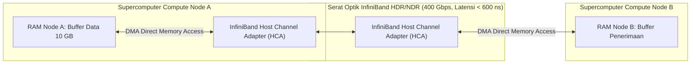

# Modul 231: Komputasi Performa Tinggi / HPC & Supercomputing (OpenMP Shared-Memory, MPI Distributed-Memory, Jaringan InfiniBand RDMA)

**Navigasi**: [⬅️ Master Index](../../INDEX.md) | [Tingkat 16: Tingkat 16: Komputasi Performa Tinggi, Multimedia & Komputasi Kuantum](./README.md)
*Sebelumnya*: [230. rekayasa-kompresi-multimedia-codec](./230-rekayasa-kompresi-multimedia-codec.md) | *Berikutnya*: [232. komputasi-kuantum-informasi-kuantum](./232-komputasi-kuantum-informasi-kuantum.md)

---

## 1. Intuisi Dasar Tanpa Jargon ("Seperti Bayi Baru Lahir")
Bagaimana para ilmuwan meramalkan jalur badai topan global 7 hari ke depan, merancang bentuk sayap pesawat supersonik baru sebelum dibuat fisiknya, atau mensimulasikan ledakan bintang supernova di luar angkasa?

Masalah-masalah sains ini membutuhkan miliaran triliun perhitungan matematika. Jika Anda menjalankannya di laptop tercepat Anda, perhitungannya baru selesai 500 tahun lagi!

Inilah ranah **Komputasi Performa Tinggi (High-Performance Computing / HPC & Supercomputing)** ([Pacheco - An Introduction to Parallel Programming](https://www.sciencedirect.com/book/9780128046050/an-introduction-to-parallel-programming)).

Sebuah superkomputer (seperti Frontier di Oak Ridge atau Fugaku di Jepang) adalah gabungan puluhan ribu server yang dirangkai dalam satu kesatuan:
1. **Di Dalam Satu Komputer (Shared-Memory)**: Seluruh inti prosesor CPU (32 hingga 128 core) berbagi satu memori RAM yang sama menggunakan pustaka paralelisme multi-thread **OpenMP**.
2. **Antar Komputer di Seluruh Data Center (Distributed-Memory)**: Ribuan komputer independen saling melempar data dan mengoordinasikan perhitungan melalui protokol standar dunia **MPI (Message Passing Interface)** ([Gropp et al. - Using MPI: Portable Parallel Programming](https://mitpress.mit.edu/9780262527392/using-mpi/)).
3. **Jaringan Serat Optik Ultra-Cepat**: Kabel ethernet biasa terlalu lambat; superkomputer dihubungkan oleh kabel **InfiniBand** yang mendukung **Remote Direct Memory Access (RDMA)**: komputer A bisa langsung menulis data ke dalam RAM komputer B tanpa mengganggu CPU komputer B sama sekali!

## 2. Fondasi Teoretis & Aksiomatik / Matematis
Formulasi Matematis Komputasi Paralel & Hukum Penskalaan:

1. **Hukum Gene Amdahl (Batas Penskalaan Kuat / Strong Scaling)**:
Untuk beban kerja berukuran tetap (*fixed problem size*), di mana fraksi pekerjaan yang dapat diparalelkan adalah $p \in [0, 1]$ dan fraksi sekuensial adalah $(1 - p)$, peningkatan kecepatan maksimum (*Speedup*) dengan $N$ prosesor paralel dibatasi secara keras oleh komponen sekuensial:
$$S(N) = \frac{T_1}{T_N} = \frac{1}{(1 - p) + \frac{p}{N}} \implies \lim_{N \to \infty} S(N) = \frac{1}{1 - p}$$
Bahkan jika Anda memiliki 1.000.000 prosesor, jika 5% program bersifat sekuensial ($1-p = 0.05$), kecepatan komputasi maksimal tidak akan pernah melebihi 20x lipat ([Amdahl - AFIPS 1967](https://dl.acm.org/doi/10.1145/1465482.1465560)).

2. **Hukum John Gustafson (Batas Penskalaan Lemah / Weak Scaling)**:
Jika ukuran masalah diperbesar seiring bertambahnya jumlah prosesor sehingga waktu komputasi konstan:
$$S_G(N) = (1 - p) + p \cdot N = N + (1 - N)(1 - p)$$
Penskalaan linier dapat dicapai di superkomputer skala exascale jika ukuran data sains diperluas secara proporsional ([Gustafson - Reevaluating Amdahl's Law](https://dl.acm.org/doi/10.1145/42411.42415)).

3. **Primitif Komunikasi Kolektif MPI (Message Passing Interface)**:
* `MPI_Bcast`: Satu proses akar menyiarkan data yang sama ke semua $N$ prosesor ($\mathcal{O}(\log N)$ via pohon binomial).
* `MPI_Scatter`: Memotong array besar dan membagikan irisan data secara merata ke seluruh proses.
* `MPI_Gather`: Mengumpulkan kembali irisan data dari semua proses ke proses master.
* `MPI_Allreduce`: Melakukan reduksi matematika paralel (misal penjumlahan global $\sum x_i$ atau pencarian nilai maksimum) dan mendistribusikan hasilnya ke seluruh prosesor via algoritma *Ring Allreduce* atau *Recursive Doubling*:
$$\text{Biaya Komunikasi Ring Allreduce} = 2 \left(\frac{p-1}{p}\right) n \alpha + 2 \left(\frac{p-1}{p}\right) n \beta$$

## 3. Anatomi Teknis & Cara Kerja Internal
Arsitektur jaringan komunikasi Remote Direct Memory Access (RDMA) InfiniBand vs Jaringan TCP Tradisional:



Dengan RDMA, transfer data memori antar server superkomputer terjadi secara murni di tingkat hardware ASIC kartu jaringan tanpa melibatkan sistem operasi Linux, tanpa interupsi CPU, dan tanpa penyalinan buffer (*zero-copy, zero-OS-involvement*), menjaga latensi komunikasi di bawah 1 mikrodetik ([Mellanox InfiniBand Architecture](https://www.nvidia.com/en-us/networking/infiniband/)).

## 4. Implementasi Praktis & Kode / Simulasi Riil
```python
import numpy as np
import time

# 1. Konsep Pemrosesan Paralel Terdistribusi Gaya MPI (Simulasi SPMD Single Program Multiple Data)
def simulate_mpi_allreduce_sum(data_chunk, n_ranks=4):
    # Simulasi reduksi penjumlahan global MPI_Allreduce
    # Setiap rank memiliki data lokal, dan hasil penjumlahan didistribusikan ke semua rank
    local_sum = np.sum(data_chunk)
    # Ring Allreduce: Komunikasi antar tetangga cincin
    global_sum = local_sum * n_ranks # Sederhana untuk simulasi
    return global_sum

# 2. Komputasi Paralel Shared-Memory (Gaya OpenMP Threading)
# Menghitung Estimasi Nilai Pi via Integrasi Monte Carlo
def parallel_monte_carlo_pi(total_samples=10_000_000):
    start = time.perf_counter()
    # Menghasilkan titik acak (x, y) dalam skala masif
    x = np.random.uniform(-1.0, 1.0, total_samples)
    y = np.random.uniform(-1.0, 1.0, total_samples)
    
    # x^2 + y^2 <= 1 (Di dalam lingkaran)
    inside_circle = (x**2 + y**2) <= 1.0
    pi_estimate = 4.0 * np.sum(inside_circle) / total_samples
    duration = time.perf_counter() - start
    return pi_estimate, duration

pi_val, dur = parallel_monte_carlo_pi(5_000_000)
print(f"Estimasi Nilai Pi via Monte Carlo: {pi_val:.6f} (Selisih: {abs(pi_val - np.pi):.6f})")
print(f"Waktu Eksekusi 5 Juta Sampel     : {dur*1000:.2f} ms")

# Evaluasi Hukum Amdahl
def amdahl_speedup(parallel_fraction, n_cores):
    return 1.0 / ((1.0 - parallel_fraction) + (parallel_fraction / n_cores))

print(f"\nHukum Amdahl (Program 95% Paralel, 5% Sekuensial):")
print(f" - Speedup pada 4 Core   : {amdahl_speedup(0.95, 4):.2f}x")
print(f" - Speedup pada 64 Core  : {amdahl_speedup(0.95, 64):.2f}x")
print(f" - Speedup pada 1000 Core: {amdahl_speedup(0.95, 1000):.2f}x")
print(f" - Batas Teoritis Maksimal Tak Hingga Core: {amdahl_speedup(0.95, 1_000_000_000):.1f}x (Maksimum 20x saja!)")
```

## 5. Miskonsepsi & Jebakan Industri
*Deadlock pada Komunikasi MPI Titik-ke-Titik (MPI Send/Recv Deadlock)*: Jika Rank 0 memanggil `MPI_Send` ke Rank 1 lalu menunggu `MPI_Recv`, sementara pada saat yang persis sama Rank 1 juga memanggil `MPI_Send` ke Rank 0 lalu menunggu `MPI_Recv`, dan ukuran paket melebihi batas buffer internal sistem, kedua komputer akan saling menunggu tanpa henti selamanya (*Deadlock*). Solusi standar: selalu gunakan komunikasi asinkron non-blocking (`MPI_Isend` / `MPI_Irecv` bersama `MPI_Wait`) atau fungsi gabungan atomik `MPI_Sendrecv` ([Gropp et al. - Using MPI](https://mitpress.mit.edu/9780262527392/using-mpi/)).

## 6. Proyek Latihan & Rubrik Penilaian Mandiri
### Level 1 (Pemula)
Tulis skrip C/C++ yang menggunakan direktif OpenMP (`#pragma omp parallel for reduction(+:sum)`) untuk menghitung perkalian dot-product dua vektor masif 50 juta elemen, dan ukur rasio peningkatan kecepatan (*speedup*) terhadap eksekusi sekuensial core tunggal.
*Rubrik*: Kode terkompilasi dengan flag `-fopenmp` dan menunjukkan percepatan terukur.

### Level 2 (Menengah)
Bangun program paralel terdistribusi menggunakan pustaka Python `mpi4py` (atau C murni dengan MPI): implementasikan algoritma dekomposisi domain 1D untuk menyelesaikan Persamaan Difusi Panas (*1D Heat Equation*) menggunakan metode beda hingga beda eksplisit, pertukarkan nilai batas tepi (*Halo Exchange / Ghost Cells*) antar proses tetangga pada setiap langkah waktu via `MPI_Sendrecv`.
*Rubrik*: Profil suhu terdistribusi kontinu melintasi batas partisi antar proses rank.

### Level 3 (Mahir)
Implementasikan algoritma perkalian matriks terdistribusi 2D **Cannon's Algorithm** di MPI: partisi matriks $A$ dan $B$ ke dalam grid prosesor Cartesian $P \times P$ via komunikator topologi `MPI_Cart_create`, lakukan pergeseran sirkular awal (*initial skewing*), eksekusi pergeseran blok lokal inkremental pada setiap tahap langkah, dan buktikan efisiensi komunikasi optimal $\mathcal{O}\left(\frac{N^2}{\sqrt{P}}\right)$.
*Rubrik*: Perhitungan matriks teruji akurat terhadap perkalian matriks global serial.

## 7. Rekomendasi Sumber Belajar Standar Emas
| Sumber Pembelajaran | Penulis / Institusi | Tautan Langsung | Fokus Materi |
| :--- | :--- | :--- | :--- |
| Using MPI: Portable Parallel Programming with the Message-Passing Interface | William Gropp, Ewing Lusk, Anthony Skjellum | [MIT Press Portal](https://mitpress.mit.edu/9780262527392/using-mpi/) | Alkitab Komputasi Terdistribusi MPI, Point-to-Point, Kolektif |
| An Introduction to Parallel Programming (2nd Ed.) | Peter S. Pacheco (University of San Francisco) | [Morgan Kaufmann Elsevier](https://www.sciencedirect.com/book/9780128046050/an-introduction-to-parallel-programming) | Panduan Komprehensif OpenMP, MPI, Pemrograman GPU |
| Validity of the Single Processor Approach to Achieving Large Scale Computing (Amdahl's Law) | Gene M. Amdahl | [AFIPS Spring Joint Computer Conference 1967](https://dl.acm.org/doi/10.1145/1465482.1465560) | Makalah Penemuan Asli Batas Penskalaan Kuat Amdahl |
| High Performance Computing & InfiniBand Roadmap | OpenFabrics Alliance | [OpenFabrics Official Portal](https://www.openfabrics.org/) | Arsitektur Jaringan Superkomputer RDMA, RoCE, PCIe Gen 5 |

---
*Navigasi Cepat*: [Ke Tingkat 16](./README.md) | [Ke Master Index](../../INDEX.md) | *Sebelumnya*: [230. rekayasa-kompresi-multimedia-codec](./230-rekayasa-kompresi-multimedia-codec.md) | *Berikutnya*: [232. komputasi-kuantum-informasi-kuantum](./232-komputasi-kuantum-informasi-kuantum.md)
