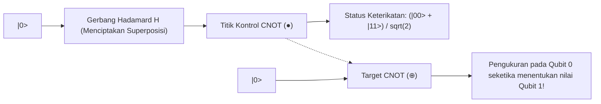

# Modul 232: Komputasi Kuantum & Ilmu Informasi Kuantum (Qubit Superposisi, Keterikatan Bell, Gerbang Kuantum Hadamard/CNOT, Algoritma Shor)

**Navigasi**: [⬅️ Master Index](../../INDEX.md) | [Tingkat 16: Tingkat 16: Komputasi Performa Tinggi, Multimedia & Komputasi Kuantum](./README.md)
*Sebelumnya*: [231. komputasi-performa-tinggi-hpc-supercomputing](./231-komputasi-performa-tinggi-hpc-supercomputing.md) | *Berikutnya*: *Puncak Kurikulum (Tuntas 100%)*

---

## 1. Intuisi Dasar Tanpa Jargon ("Seperti Bayi Baru Lahir")
Di dunia komputer klasik yang kita kenal hari ini, sebutir informasi terkecil (**Bit**) bekerja seperti saklar lampu biasa: saklar hanya bisa berada di salah satu dari dua kondisi: mati (**0**) atau hidup (**1**).

Namun di dunia mekanika kuantum yang mikroskopis, alam semesta bekerja dengan aturan yang sangat berbeda dan gila. Sebutir partikel kuantum (**Qubit / Quantum Bit**) bekerja seperti koin yang sedang berputar kencang di atas meja: selama ia masih berputar dan belum Anda tepuk dengan tangan, koin tersebut berada di dalam kondisi **Superposisi**—ia adalah angka 0 dan angka 1 secara bersamaan dengan bobot probabilitas tertentu ([Nielsen & Chuang - Quantum Computation and Quantum Information](https://www.cambridge.org/highereducation/books/quantum-computation-and-quantum-information/017846429A887C08F4C6E404E249E6E8)).

Jika Anda memiliki 300 qubit dalam kondisi superposisi dan saling terikat (**Quantum Entanglement**), komputer kuantum dapat menampung $2^{300}$ bilangan secara serempak di dalam ruang memorinya—angka ini lebih banyak daripada seluruh jumlah atom yang ada di seluruh alam semesta raya!

Dan apa yang bisa dilakukannya? Matematikawan Peter Shor menemukan bahwa komputer kuantum dapat memfaktorkan bilangan prima raksasa dalam hitungan menit menggunakan **Algoritma Shor**, meruntuhkan seluruh sistem enkripsi keamanan internet dunia (seperti RSA dan HTTPS) yang membutuhkan waktu jutaan tahun bagi superkomputer biasa untuk membobolnya ([Shor - Polynomial-Time Algorithms for Prime Factorization and Discrete Logarithms](https://arxiv.org/abs/quant-ph/9508027)).

## 2. Fondasi Teoretis & Aksiomatik / Matematis
Formulasi Matematis Ruang Hilbert & Sirkuit Informasi Kuantum:

1. **Status Status Qubit dalam Ruang Hilbert Kompleks $\mathbb{C}^2$**:
Status kuantum murni dinyatakan dalam notasi bra-ket Dirac:
$$|\psi\rangle = \alpha |0\rangle + \beta |1\rangle = \begin{bmatrix} \alpha \\ \beta \end{bmatrix}, \quad \alpha, \beta \in \mathbb{C}$$
*Postulat Pengukuran Born*: Peluang mengamati status $|0\rangle$ adalah $|\alpha|^2$ dan $|1\rangle$ adalah $|\beta|^2$, dengan syarat normalisasi mutlak:
$$\langle \psi \mid \psi \rangle = |\alpha|^2 + |\beta|^2 = 1$$
Representasi Bola Bloch 3D:
$$|\psi\rangle = \cos\left(\frac{\theta}{2}\right) |0\rangle + e^{j\phi} \sin\left(\frac{\theta}{2}\right) |1\rangle, \quad \theta \in [0, \pi], \phi \in [0, 2\pi)$$

2. **Gerbang Logika Kuantum Uniter (Unitary Quantum Gates)**:
Evolusi waktu sistem kuantum tertutup dikendalikan oleh operator matriks uniter $U^\dagger U = I$:
* Gerbang Pauli: $X = \begin{bmatrix} 0 & 1 \\ 1 & 0 \end{bmatrix}$ (NOT Gate), $Z = \begin{bmatrix} 1 & 0 \\ 0 & -1 \end{bmatrix}$ (Phase Flip).
* Gerbang Hadamard ($H$): Menciptakan status superposisi seimbang dari basis komputasi:
$$H = \frac{1}{\sqrt{2}} \begin{bmatrix} 1 & 1 \\ 1 & -1 \end{bmatrix} \implies H|0\rangle = \frac{|0\rangle + |1\rangle}{\sqrt{2}} = |+\rangle$$
* Gerbang Dua-Qubit Controlled-NOT (CNOT):
$$\text{CNOT} = \begin{bmatrix} 1 & 0 & 0 & 0 \\ 0 & 1 & 0 & 0 \\ 0 & 0 & 0 & 1 \\ 0 & 0 & 1 & 0 \end{bmatrix}, \quad \text{CNOT}(H|0\rangle \otimes |0\rangle) = \frac{|00\rangle + |11\rangle}{\sqrt{2}} = |\Phi^+\rangle \quad (\text{Bell State Entangled!})$$

3. **Algoritma Kuantum Shor & Quantum Fourier Transform (QFT)**:
Memfaktorkan bilangan bulat $N$ dalam kompleksitas polinomial $\mathcal{O}((\log N)^3)$ dengan mereduksinya ke masalah pencarian periode (*Period Finding*) dari fungsi modular $f(x) = a^x \pmod N$:
$$|\tilde{k}\rangle = \text{QFT}|j\rangle = \frac{1}{\sqrt{2^n}} \sum_{k=0}^{2^n-1} e^{2\pi i j k / 2^n} |k\rangle$$
Interferensi destruktif membatalkan seluruh tebakan fase yang salah, sementara interferensi konstruktif memperkuat amplitudo probabilitas periode sejati $r$ hingga mencapai probabilitas deteksi mendekati 1 ([Shor 1994](https://arxiv.org/abs/quant-ph/9508027)).

4. **Algoritma Pencarian Basis Data Tak Terstruktur Grover**:
Mempercepat pencarian database tak terurut dari $\mathcal{O}(N)$ menjadi $\mathcal{O}(\sqrt{N})$ kuadratik via operator refleksi Householder: $G = (2|\psi\rangle\langle\psi| - I) O$ ([Grover - A Fast Quantum Mechanical Algorithm for Database Search](https://arxiv.org/abs/quant-ph/9605043)).

## 3. Anatomi Teknis & Cara Kerja Internal
Arsitektur sirkuit kuantum pembuatan Status Keterikatan Bell (Bell State Entanglement):



Ketika dua qubit berada dalam status keterikatan Bell ($|\Phi^+\rangle$), jika qubit pertama diukur di bumi dan menghasilkan angka 0, qubit kedua di planet Mars akan seketika runtuh menjadi angka 0 pada saat yang persis sama, membuktikan fenomena *"Spooky action at a distance"* yang sempat diperdebatkan oleh Albert Einstein ([Einstein, Podolsky, Rosen - Can Quantum-Mechanical Description of Physical Reality be Considered Complete?](https://journals.aps.org/pr/abstract/10.1103/PhysRev.47.777)).

## 4. Implementasi Praktis & Kode / Simulasi Riil
```python
import numpy as np

# 1. Definisi Matriks Operator Uniter Kuantum Dasar
H = (1.0 / np.sqrt(2.0)) * np.array([[1.0, 1.0], [1.0, -1.0]], dtype=complex)
X = np.array([[0.0, 1.0], [1.0, 0.0]], dtype=complex)
Z = np.array([[1.0, 0.0], [0.0, -1.0]], dtype=complex)
I = np.eye(2, dtype=complex)

# Gerbang CNOT 4x4: Mengontrol Qubit Target berdasarkan Qubit Kontrol
CNOT = np.array([
    [1, 0, 0, 0],
    [0, 1, 0, 0],
    [0, 0, 0, 1],
    [0, 0, 1, 0]
], dtype=complex)

# Status Dasar Dua Qubit: |00> = |0> (x) |0>
ket_0 = np.array([[1.0], [0.0]], dtype=complex)
state_00 = np.kron(ket_0, ket_0) # Tensor Product

# 2. Pembuatan Sirkuit Keterikatan Kuantum Bell State: CNOT * (H (x) I) * |00>
# Langkah 1: Terapkan Hadamard pada Qubit 0
step1_op = np.kron(H, I)
state_after_h = step1_op @ state_00

# Langkah 2: Terapkan CNOT antara Qubit 0 (Kontrol) dan Qubit 1 (Target)
bell_state = CNOT @ state_after_h

print("Vektor Status Kuantum Bell State (|Phi+>):")
print(f"|Phi+> = {bell_state[0, 0]:.3f} |00> + {bell_state[1, 0]:.3f} |01> + {bell_state[2, 0]:.3f} |10> + {bell_state[3, 0]:.3f} |11>")

# Simulasi Pengukuran Born (Born Rule Probability)
probabilities = np.abs(bell_state.flatten()) ** 2
print("\nProbabilitas Pengukuran:")
print(f" - Peluang |00> : {probabilities[0]*100:.1f}%")
print(f" - Peluang |01> : {probabilities[1]*100:.1f}% (Nol Mutlak)")
print(f" - Peluang |10> : {probabilities[2]*100:.1f}% (Nol Mutlak)")
print(f" - Peluang |11> : {probabilities[3]*100:.1f}%")
print("Kedua qubit 100% terikat sempurna: Tidak akan pernah teramati kondisi |01> atau |10>!")
```

## 5. Miskonsepsi & Jebakan Industri
*Dekoharansi Kuantum & Kebisingan NISQ (Quantum Decoherence)*: Qubit fisik (seperti sirkuit superkonduktor transmon atau perangkap ion) sangat rapuh. Gangguan panas sekecil fluktuasi suhu $0.001\text{ Kelvin}$ atau radiasi gelombang mikro liar akan menyebabkan fungsi gelombang kuantum runtuh (*decoherence*) dalam waktu beberapa mikrodetik ($T_1, T_2 < 100\ \mu\text{s}$), merusak seluruh komputasi kuantum menjadi derau acak. Komputer kuantum masa kini (era NISQ) belum memiliki toleransi kesalahan penuh; komputasi skala besar membutuhkan algoritma koreksi galat kuantum (**Quantum Error Correction / Surface Codes**) yang membutuhkan ribuan qubit fisik hanya untuk mengamankan 1 qubit logika murni ([Preskill - Quantum Computing in the NISQ era and beyond](https://quantum-journal.org/papers/q-2018-08-06-79/)).

## 6. Proyek Latihan & Rubrik Penilaian Mandiri
### Level 1 (Pemula)
Gunakan pustaka Qiskit (IBM) atau Cirq (Google) di Python untuk membuat sirkuit kuantum 2-qubit: pasang gerbang Hadamard pada qubit 0, gerbang CNOT, lakukan pengukuran pada kedua qubit ke dalam register klasik, simulasikan pada backend `AerSimulator` sebanyak 1.000 tembakan (*shots*), dan buktikan distribusi hasil pengukuran hanya terdiri dari '00' (~50%) dan '11' (~50%).
*Rubrik*: Kode sirkuit Qiskit tereksekusi dan menampilkan histogram frekuensi hasil pengukuran.

### Level 2 (Menengah)
Bangun simulator sirkuit Transformasi Fourier Kuantum (*Quantum Fourier Transform / QFT*) 3-qubit dari nol di Qiskit atau matriks aljabar NumPy murni: rancang urutan gerbang Hadamard dan gerbang fase terkontrol $R_k = \begin{bmatrix} 1 & 0 \\ 0 & e^{2\pi i / 2^k} \end{bmatrix}$, tambahkan operasi pembalik posisi Swap Gate di akhir sirkuit, dan buktikan bahwa QFT memetakan basis waktu diskret ke representasi frekuensi fase.
*Rubrik*: Matriks representasi uniter sirkuit cocok dengan matriks DFT matematis berdimensi $8 \times 8$.

### Level 3 (Mahir)
Implementasikan algoritma pencarian kuantum **Grover Search** lengkap untuk menemukan satu item rahasia di antara $N = 16$ kemungkinan (ruang 4-qubit): rancang operator Oracle pembalik fasa target ($O = I - 2|x^*\rangle\langle x^*|$), rancang operator Diffuser Grover ($2|\psi\rangle\langle\psi| - I$), hitung jumlah iterasi optimal $R \approx \frac{\pi}{4}\sqrt{N} \approx 3$ kali, dan buktikan secara komputasional bahwa probabilitas keberhasilan menemukan item melonjak dari $6.25\%$ menjadi $> 96\%$.
*Rubrik*: Amplitudo probabilitas target berhasil diamplifikasi melebihi batas $95\%$ setelah 3 iterasi.

## 7. Rekomendasi Sumber Belajar Standar Emas
| Sumber Pembelajaran | Penulis / Institusi | Tautan Langsung | Fokus Materi |
| :--- | :--- | :--- | :--- |
| Quantum Computation and Quantum Information (10th Anniversary Ed.) | Michael A. Nielsen & Isaac L. Chuang | [Cambridge University Press](https://www.cambridge.org/highereducation/books/quantum-computation-and-quantum-information/017846429A887C08F4C6E404E249E6E8) | Alkitab Komputasi Kuantum, Sirkuit, QFT, Error Correction |
| Polynomial-Time Algorithms for Prime Factorization and Discrete Logarithms | Peter W. Shor (AT&T Bell Labs) | [arXiv Shor's Algorithm Paper](https://arxiv.org/abs/quant-ph/9508027) | Makalah Penemuan Asli Algoritma Faktorisasi Kuantum Shor |
| A Fast Quantum Mechanical Algorithm for Database Search (Grover) | Lov K. Grover (Bell Labs) | [arXiv Grover's Algorithm Paper](https://arxiv.org/abs/quant-ph/9605043) | Algoritma Pencarian Basis Data Kuantum, Operator Difusi |
| Quantum Computing in the NISQ era and beyond | John Preskill (Caltech) | [Quantum Journal 2018](https://quantum-journal.org/papers/q-2018-08-06-79/)) | Tinjauan Era NISQ, Batasan Fisik Qubit, Surface Codes |

---
*Navigasi Cepat*: [Ke Tingkat 16](./README.md) | [Ke Master Index](../../INDEX.md) | *Sebelumnya*: [231. komputasi-performa-tinggi-hpc-supercomputing](./231-komputasi-performa-tinggi-hpc-supercomputing.md) | *Berikutnya*: *Puncak Kurikulum (Tuntas 100%)*
