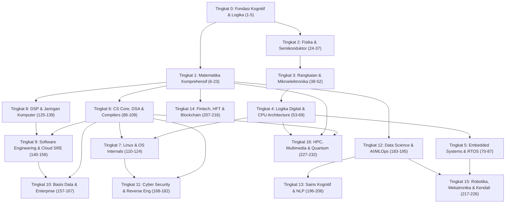

# Prerequisites Directed Acyclic Graph (DAG) — Peta Ketergantungan Topik

Dokumen ini memetakan hubungan logis dan prasyarat antar-tingkat pembelajaran dalam kurikulum **17 Tingkat (Tingkat 0 s/d 16)**. Struktur kurikulum dirancang sebagai **Directed Acyclic Graph (DAG)** di mana Anda dapat mempelajari topik-topik secara linear atau melintasi jalur spesialisasi peran (*role-based learning tracks*).

---

## 🗺️ Diagram Ketergantungan Tingkat Utama

---

## 🎯 Jalur Spesialisasi Karier & Rekayasa

### 1. Jalur AI Systems & LLM Architect
- **Urutan Belajar**: Tingkat 0 $\to$ Tingkat 1 (Aljabar Linier, Probabilitas, Optimasi) $\to$ Tingkat 6 (Struktur Data) $\to$ Tingkat 12 (Machine Learning, Autograd, CUDA) $\to$ Tingkat 13 (Transformer, MoE, RLHF, Autonomous Agents).
- **Fokus Utama**: Matematika tensor, pemrograman CUDA GPU, arsitektur attention, scaling laws, dan MLOps.

### 2. Jalur Embedded Systems, Firmware & Robotics Engineer
- **Urutan Belajar**: Tingkat 0 $\to$ Tingkat 2 (Fisika, Semikonduktor) $\to$ Tingkat 3 (Rangkaian Listrik, MOSFET) $\to$ Tingkat 4 (Digital Logic, CPU) $\to$ Tingkat 5 (Bare-Metal C, DMA, RTOS) $\to$ Tingkat 15 (Kinematika DH, PID/LQR, ROS 2, SLAM).
- **Fokus Utama**: Manipulasi bitwise, interupsi NVIC, osiloskop, kendali motor FOC, dan simulator Gazebo.

### 3. Jalur Low-Level Systems, Kernel & Security Researcher
- **Urutan Belajar**: Tingkat 0 $\to$ Tingkat 1 (Matematika Diskrit) $\to$ Tingkat 4 (Arsitektur Komputer x86-64/ARM) $\to$ Tingkat 6 (Compilers, C, Memory Management) $\to$ Tingkat 7 (Linux OS Internals, Syscalls, eBPF) $\to$ Tingkat 11 (Kriptografi, Binary Exploitation ROP, Kernel Pwn).
- **Fokus Utama**: Disassembling Ghidra, bypass mitigasi memori, reverse engineering, dan audit kernel Linux.

### 4. Jalur Quantitative Trading, Financial Engineering & HFT
- **Urutan Belajar**: Tingkat 0 $\to$ Tingkat 1 (Kalkulus Stokastik, Time Series, Game Theory) $\to$ Tingkat 4 (Arsitektur CPU Cache, Bus PCIe) $\to$ Tingkat 6 (DSA Berkinerja Tinggi) $\to$ Tingkat 14 (Mikrostruktur Pasar LOB, Lock-Free SPSC C++, Kernel-Bypass DPDK, FPGA).
- **Fokus Utama**: Zero-allocation C++, protokol NASDAQ ITCH, persamaan Black-Scholes, dan latensi sub-mikrodetik.

---
*Kembali ke: [Master Index](../INDEX.md) | [Portal Utama](../README.md)*